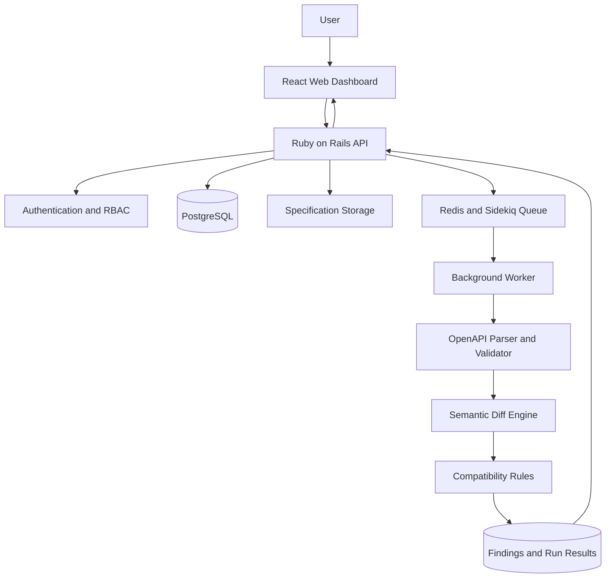
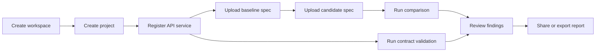
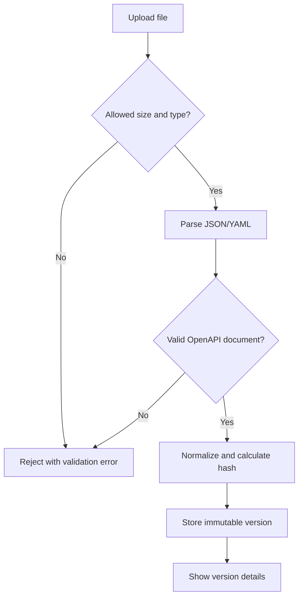
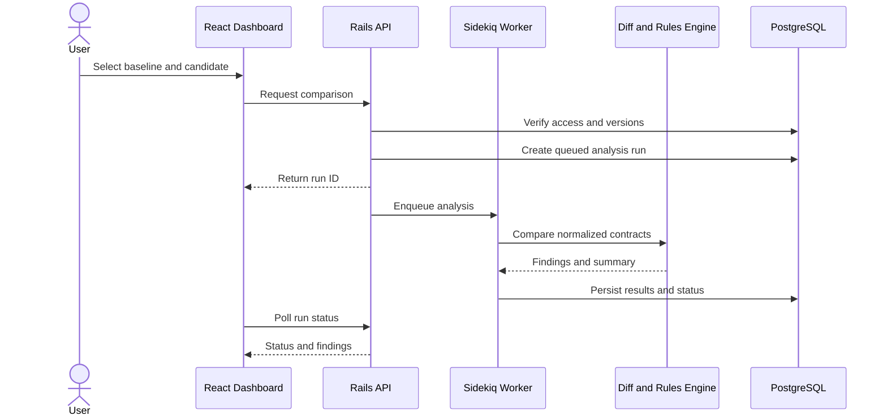
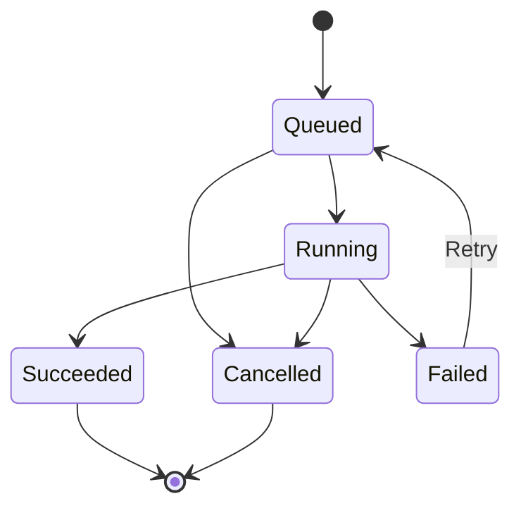
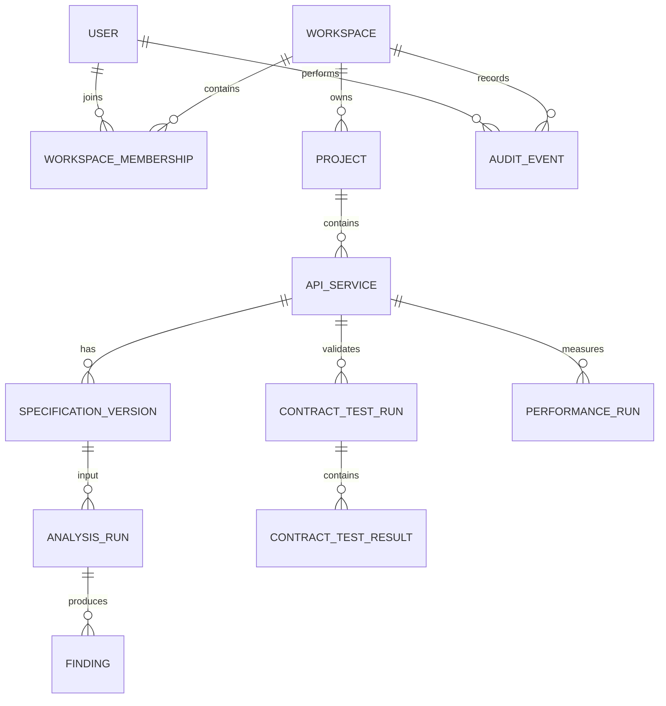

# ContractIQ — Software Requirements Specification (SRS)

**Version:** 1.1.0  
**Status:** Updated technology stack  
**Date:** 2026-11-16

## 1. Introduction

### 1.1 Purpose

This document defines the functional and non-functional requirements for ContractIQ, an API intelligence platform that helps engineering teams understand API contracts, detect compatibility risks, validate implementations, and track API quality over time.

### 1.2 Scope

ContractIQ will let teams:
- Register API services and upload or import OpenAPI specifications.
- Store and version API contracts.
- Compare contract versions and identify potentially breaking changes.
- Run contract validation and configurable performance checks.
- Review findings, reports, and audit history in a workspace dashboard.

The initial release focuses on OpenAPI-based HTTP APIs. It is not intended to replace API gateways, production observability platforms, or a full API management suite.

### 1.3 Definitions

- **API contract:** Machine-readable description of an API's endpoints, operations, schemas, parameters, and responses.
- **Baseline:** The previously accepted specification used for comparison.
- **Candidate:** The newer specification being evaluated.
- **Breaking change:** A change that may cause an existing consumer or integration to fail.
- **Analysis run:** A recorded execution of contract comparison or validation.

## 2. Product overview

### 2.1 Product goals

1. Make API changes understandable and reviewable.
2. Detect compatibility risks before release.
3. Provide repeatable contract validation.
4. Maintain a traceable history of specifications, findings, and runs.
5. Support multiple teams with isolated workspaces and role-based access.

### 2.2 Success measures

- A user can upload a valid specification and receive a parse/validation result.
- A user can compare two versions and inspect each detected change.
- Findings include severity, rationale, affected operation/schema, and evidence.
- Every run is attributable to a user, project, input versions, and timestamp.
- Workspace data is isolated across tenants.

### 2.3 Initial supported formats

- OpenAPI 3.0.x: initial target.
- OpenAPI 3.1.x: target before general availability; support must be verified against the chosen parser and rules engine.
- JSON and YAML encodings.

## 3. Users and roles

| Role | Permissions |
|---|---|
| Workspace Owner | Full workspace control, billing/configuration placeholder, members, projects |
| Admin | Manage members, projects, services, and settings |
| Developer | Upload specs, run analysis/tests, view reports |
| Viewer | Read-only access to projects and reports |
| Platform Operator | Operational access for platform maintenance; access must be audited |

Authorization must be enforced server-side for every workspace-scoped resource.

## 4. System context and architecture

### 4.1 High-level workflow

### 4.2 Logical components

- **Frontend:** React and TypeScript workspace navigation, service/specification management, comparison views, findings, and reports.
- **Backend API:** Ruby on Rails API-only application responsible for authentication, authorization, validation, orchestration, and REST endpoints.
- **Specification service:** Safe upload, parsing, normalization, and version storage.
- **Diff engine:** Semantic comparison of baseline and candidate contracts.
- **Rules engine:** Classifies changes and explains compatibility impact.
- **Job system:** Sidekiq workers backed by Redis run longer analysis and test tasks asynchronously.
- **Persistence:** PostgreSQL stores relational metadata; specification artifacts use a controlled storage abstraction.

### 4.3 Architecture decision

The MVP should use a modular monolith with clearly separated modules. Split services only when scaling, deployment independence, or team ownership justifies the added operational complexity.

The backend shall be implemented as a Rails API-only application, separate from the React frontend. The frontend communicates with Rails through versioned JSON REST endpoints.

## 5. Functional requirements

Priorities: **P0** = required for MVP; **P1** = important follow-up; **P2** = later enhancement.

### FR-001 Authentication and sessions — P0

- Users shall be able to register, sign in, and sign out.
- The system shall protect authenticated routes.
- Passwords shall be stored using a modern password-hashing algorithm.
- Session/token expiry and revocation shall be supported.

### FR-002 Workspace management — P0

- Users shall be able to create and view workspaces.
- Workspace owners/admins shall be able to invite and remove members.
- Each membership shall have one of the defined roles.
- A user shall not access another workspace's data without explicit membership.

### FR-003 Project and API service management — P0

- Users shall be able to create projects within a workspace.
- A project shall contain one or more API services.
- Services shall have a name, description, environment-independent identity, and optional repository metadata.

### FR-004 Specification ingestion — P0

- Users shall be able to upload OpenAPI JSON or YAML files.
- The system shall enforce configurable file-size limits and validate file content.
- The system shall parse and validate the document before accepting it as a usable version.
- The system shall store an immutable version and its content hash.
- Invalid files shall return actionable validation errors.

### FR-005 Specification versioning — P0

- Users shall be able to list versions for an API service.
- Each version shall record uploader, timestamp, source, format, and content hash.
- A version shall not be silently overwritten.
- Users shall be able to designate a baseline version.

### FR-006 Semantic comparison — P0

- Users shall be able to compare a baseline with a candidate version.
- The engine shall compare paths, methods, parameters, request bodies, response codes, response schemas, and security requirements.
- Results shall identify added, removed, and modified elements.
- Results shall include evidence and a stable rule identifier where applicable.

### FR-007 Breaking-change classification — P0

- The system shall classify findings as breaking, potentially breaking, non-breaking, or informational.
- Each finding shall include severity, summary, rationale, and affected API element.
- Users shall be able to filter and acknowledge findings.
- Classification shall be configurable and documented; it shall not be presented as an absolute guarantee of consumer impact.

### FR-008 Contract validation — P1

- Users shall be able to run validation against a configured test target or supplied fixtures.
- The system shall validate request/response behavior against the selected contract.
- Test execution shall be isolated, bounded, and explicitly authorized.
- Results shall include pass/fail status and diagnostic evidence.

### FR-009 Performance checks — P1

- Users shall be able to define a bounded performance profile.
- Runs shall enforce limits for duration, concurrency, request count, and target allowlist.
- Reports shall summarize latency percentiles, throughput, and error rate.
- Performance tests shall not run against arbitrary targets without explicit authorization.

### FR-010 Reports — P0

- Users shall be able to view comparison and validation reports.
- Reports shall be filterable by project, service, version, status, severity, and date.
- Reports shall link back to the exact versions and run that produced them.
- Export to a downloadable format may be added in a later release.

### FR-011 Background jobs — P0

- Long-running analysis shall execute asynchronously.
- Users shall be able to view job status: queued, running, succeeded, failed, or cancelled.
- Failures shall include a safe, useful error summary.
- Retried jobs shall not create duplicate logical results.

### FR-012 Audit history — P1

- The system shall record security-relevant actions, including membership changes, uploads, comparisons, test runs, and configuration changes.
- Audit entries shall include actor, action, target, timestamp, and outcome.
- Audit records shall be protected against ordinary user modification.

## 6. Use cases and workflows

### 6.1 Main use cases

### 6.2 Specification ingestion

### 6.3 Comparison sequence

### 6.4 Analysis run state machine

## 7. External interfaces

### 7.1 REST API

The backend shall expose versioned JSON endpoints under `/api/v1`.

Initial endpoint catalogue:
- `POST /api/v1/auth/register`
- `POST /api/v1/auth/login`
- `POST /api/v1/auth/logout`
- `GET /api/v1/workspaces`
- `POST /api/v1/workspaces`
- `GET /api/v1/workspaces/{workspaceId}/projects`
- `POST /api/v1/workspaces/{workspaceId}/projects`
- `GET /api/v1/projects/{projectId}/services`
- `POST /api/v1/projects/{projectId}/services`
- `POST /api/v1/services/{serviceId}/specifications`
- `GET /api/v1/services/{serviceId}/specifications`
- `POST /api/v1/services/{serviceId}/comparisons`
- `GET /api/v1/analysis-runs/{runId}`
- `GET /api/v1/analysis-runs/{runId}/findings`

Exact request/response schemas shall be defined in the API's own OpenAPI document.

### 7.2 Error format

Errors shall use a consistent JSON envelope containing a machine-readable code, human-readable message, optional field details, and request/correlation ID. Secrets, stack traces, and internal infrastructure details must not be returned.

### 7.3 Integrations

Git provider integration, CI status checks, notifications, and external test runners are future extensions. Any integration must use least-privilege credentials and explicit user authorization.

## 8. Data requirements

### 8.1 Core entities

- User
- Workspace
- WorkspaceMembership
- Project
- ApiService
- SpecificationVersion
- AnalysisRun
- Finding
- ContractTestRun
- ContractTestResult
- PerformanceRun
- AuditEvent
- BackgroundJob

### 8.2 Entity relationship overview

### 8.3 Data integrity

- Every workspace-owned record shall carry a workspace relationship or be reachable through a validated parent relationship.
- Foreign keys and uniqueness constraints shall enforce referential integrity.
- Specification versions shall be immutable after acceptance.
- Content hashes shall support integrity checks and deduplication where appropriate.
- Database indexes shall cover common workspace, project, service, version, and run queries.

### 8.4 Retention

Retention periods shall be configurable by deployment policy. Deletion workflows must account for related reports, uploaded specifications, audit obligations, and legal requirements.

## 9. Compatibility rule catalogue

The initial rules engine should include, at minimum, the following checks. Exact compatibility depends on API semantics and consumer behavior; findings must explain their assumptions.

| Rule ID | Change | Default classification |
|---|---|---|
| BC-001 | Remove an existing path | Breaking |
| BC-002 | Remove an HTTP operation | Breaking |
| BC-003 | Add a new required request parameter | Breaking |
| BC-004 | Remove an existing parameter | Breaking |
| BC-005 | Change parameter location | Breaking |
| BC-006 | Narrow an accepted parameter schema | Potentially breaking |
| BC-007 | Remove a response status code | Potentially breaking |
| BC-008 | Remove a response property | Potentially breaking |
| BC-009 | Make an optional request property required | Breaking |
| BC-010 | Widen a request enum restriction | Usually non-breaking |
| BC-011 | Narrow a request enum | Potentially breaking |
| BC-012 | Change request/response content type | Potentially breaking |
| BC-013 | Add a required security scheme | Breaking |
| BC-014 | Remove a security requirement | Security-impacting |
| BC-015 | Change an operation identifier | Informational or potentially breaking |
| BC-016 | Add an optional request property | Usually non-breaking |
| BC-017 | Add a response property | Usually non-breaking |
| BC-018 | Change a schema type incompatibly | Breaking |

Rules shall be versioned. Historical runs shall retain the rule-set version used at execution time so results remain reproducible.

## 10. Non-functional requirements

### NFR-001 Performance

- Common dashboard reads should target a p95 response time under 500 ms under the agreed MVP test load, excluding long-running analysis.
- Upload and analysis limits shall be configurable.
- Long-running work shall not block API request threads.

### NFR-002 Reliability

- Jobs shall have bounded retries and explicit terminal states.
- Failed jobs shall be observable and safely retryable.
- Database backups and restore procedures shall be documented before production use.

### NFR-003 Security

- Enforce authentication and workspace-level authorization.
- Use TLS in transit and encryption at rest where supported by the deployment.
- Store secrets outside source control.
- Apply rate limits to authentication, upload, and job-creation endpoints.
- Validate and sanitize all untrusted input.

### NFR-004 Maintainability

- Use modular boundaries, typed interfaces, migrations, automated tests, and documented decisions.
- Compatibility rules shall have unit tests and representative fixtures.
- API changes shall be reflected in the API specification.

### NFR-005 Usability and accessibility

- Findings shall use clear severity labels and explain the reason for classification.
- Empty, loading, success, and error states shall be explicit.
- Core workflows shall be keyboard accessible and use semantic UI elements.

### NFR-006 Observability

- Emit structured logs with correlation IDs.
- Track request latency, job duration, queue depth, failure rate, and analysis counts.
- Avoid logging credentials, tokens, or sensitive uploaded content.

## 11. Security and privacy requirements

- Enforce tenant isolation in every query and background job.
- Treat uploaded specifications and imported references as untrusted input.
- Limit file size, parser depth, reference expansion, and processing time to reduce resource-exhaustion risk.
- Do not resolve remote `$ref` URLs by default. If remote references are enabled later, use strict outbound allowlists and SSRF protections, including blocking loopback, private, link-local, and cloud metadata destinations; revalidate redirects and DNS resolutions.
- Test execution must target only explicitly configured and authorized hosts. Apply egress restrictions, request budgets, timeouts, and concurrency caps.
- Never execute uploaded scripts or treat specification content as executable code.
- Protect credentials with a secrets manager or equivalent secure storage; redact them from logs and reports.
- Apply least privilege to users, services, and integrations.
- Provide account/workspace deletion and data export policies appropriate to the deployment.
- Record privileged actions in an audit trail.

## 12. Error handling and observability

- Validation errors shall identify the relevant document location where possible.
- Unexpected failures shall return a generic client message and a correlation ID.
- Background-job failures shall preserve safe diagnostic context for authorized operators.
- Monitoring shall alert on sustained job failures, queue backlog, elevated API errors, and storage/database health issues.

## 13. Testing and acceptance criteria

### 13.1 Test levels

- Unit tests: parsers, normalization, diff rules, permissions, and validation.
- Integration tests: database, storage, job queue, and API workflows.
- End-to-end tests: registration through upload, comparison, and report review.
- Security tests: tenant isolation, authorization bypass attempts, malicious file handling, and outbound request restrictions.
- Performance tests: API reads, uploads, and bounded analysis workloads.

### 13.2 MVP acceptance criteria

1. A user can register, sign in, and create a workspace.
2. An owner/admin can add a project and API service.
3. A developer can upload a valid OpenAPI document and see a stored version.
4. An invalid or oversized document is rejected with a useful error.
5. A user can select two versions and run a comparison.
6. The comparison produces stable findings with rule IDs, severity, and evidence.
7. A user can view and filter the resulting report.
8. A user without workspace membership cannot access that workspace's resources.
9. Analysis runs expose queued, running, succeeded, and failed states.
10. Core actions are covered by automated tests and CI.

### 13.3 Definition of done

A feature is done when its acceptance criteria pass, authorization is tested, errors are handled, relevant documentation is updated, and automated checks pass in CI.

## 14. Technology stack, deployment, and operations

The following is the agreed implementation stack for the MVP.

### 14.1 Frontend

- **React:** Component-based web application and dashboard.
- **TypeScript:** Static typing for frontend application code.
- **Vite:** Frontend development server and build tooling.
- **Vitest:** Frontend unit and component tests.
- **Axios or native Fetch:** Communication with the Rails REST API.
- **Recharts:** Dashboard charts and performance visualizations.

### 14.2 Backend

- **Ruby:** Primary backend programming language.
- **Ruby on Rails (API-only mode):** Backend framework exposing versioned JSON REST endpoints.
- **Active Record:** ORM and database access layer.
- **Active Job:** Background-job interface, using Sidekiq as the production adapter.
- **RSpec:** Backend unit, request, and integration testing.
- **Puma:** Rails application server.

The backend shall be organized as a modular monolith. Domain logic for specification ingestion, normalization, semantic comparison, compatibility rules, contract validation, reporting, and monitoring shall live in separate modules/services rather than being concentrated in controllers.

### 14.3 Database and background processing

- **PostgreSQL:** Primary relational database.
- **Redis:** Queue coordination and optional caching.
- **Sidekiq:** Asynchronous processing for specification analysis, comparisons, validation, and scheduled monitoring jobs.
- **Active Storage or a storage adapter:** Controlled storage for uploaded specification artifacts, selected according to deployment needs.

### 14.4 API engineering and testing

- **OpenAPI:** Contract format and API documentation standard.
- **JSON Schema:** Schema validation where applicable.
- **Ruby-compatible OpenAPI parser/validator:** Select and verify a maintained library during the implementation spike, including OpenAPI 3.0 and required 3.1 coverage.
- **RSpec fixtures:** Reproducible test cases for compatibility rules and schema validation.
- **k6 or an equivalent controlled load-testing tool:** Performance test execution, subject to explicit target authorization and strict request/time/concurrency limits.

The semantic diff and compatibility rules must be deterministic and covered by automated tests. Library selection must not replace the platform's own documented compatibility policy.

### 14.5 Infrastructure and delivery

- **Docker and Docker Compose:** Reproducible local development environment for frontend, Rails, PostgreSQL, Redis, and Sidekiq.
- **GitHub Actions:** Continuous integration for linting, tests, dependency checks, and build verification.
- **Nginx or a managed reverse proxy:** Optional production routing and TLS termination.
- **Environment variables and a secrets manager:** Configuration and secret handling.

### 14.6 Deployment requirements

Production deployment shall define environment configuration, secret management, database migration procedure, backup/restore, health checks, logging, queue monitoring, and rollback steps.

Performance and contract-test jobs must run asynchronously and must enforce target allowlists, timeouts, request budgets, and concurrency caps. Background jobs must verify workspace authorization and must not trust user-supplied job arguments without revalidation.

## 15. MVP scope and delivery phases

### MVP

- Authentication and workspace roles.
- Projects and API services.
- OpenAPI upload, validation, and immutable versioning.
- Semantic comparison and initial breaking-change rules.
- Analysis job lifecycle using Sidekiq.
- Findings dashboard and report view.
- Tenant isolation and automated tests.

### Phase 2

- Contract test execution against authorized targets.
- CI integration and notifications.
- Performance checks with strict safeguards.
- Report export and richer audit history.

### Phase 3

- Additional API description formats.
- Team policy configuration and custom rules.
- Advanced analytics and organization-wide API catalogue.

## 16. Assumptions, dependencies, and open decisions

### Assumptions

- The first product release is for engineering teams working with HTTP APIs.
- OpenAPI is the initial source of truth for API contracts.
- Users are responsible for ensuring they are authorized to test configured API targets.
- React and Ruby on Rails are the agreed frontend and backend technologies.

### Dependencies

- A maintained Ruby-compatible OpenAPI parser and validator.
- Secure relational database and object/file storage.
- Authentication/session implementation.
- Redis and Sidekiq for asynchronous analysis workloads.

### Open decisions

- Final authentication strategy (server sessions vs. token-based).
- Whether specification artifacts use Active Storage with local/object storage or a dedicated storage adapter.
- Exact OpenAPI 3.1 support boundary and parser-library selection.
- Final compatibility semantics for nuanced schema changes.
- Performance-test engine and safe target authorization UX.
- Deployment model and retention defaults.

## 17. Glossary

- **API:** Application Programming Interface.
- **OpenAPI:** A standard format for describing HTTP APIs.
- **Schema:** A definition of the structure and constraints of data.
- **Semantic diff:** Comparison of meaning and structure rather than raw text.
- **SSRF:** Server-Side Request Forgery, a risk where a server is tricked into making unintended requests.
- **RBAC:** Role-Based Access Control.
- **p95:** The value below which 95% of measured observations fall.
- **ROR:** Ruby on Rails.

## Appendix A — Example MVP acceptance scenario

**Given** a service has an accepted baseline specification and a candidate specification,  
**when** a developer starts a comparison,  
**then** the system creates an analysis run, compares normalized contracts, stores findings, and presents a report linked to both immutable versions.

## Appendix B — Traceability

Each functional requirement shall map to one or more implementation tasks and automated tests. Rule IDs shall map to fixture files that demonstrate the expected classification.

## Appendix C — Change control

Changes to this SRS shall update the version, date, and a short change summary in the commit message or pull request. Product, engineering, and security stakeholders should review changes affecting scope, compatibility semantics, data handling, or test execution.

### Change log

- **1.1.0 — 2026-11-16:** Updated the implementation stack from React + FastAPI + SQLAlchemy to React + TypeScript + Ruby on Rails (API-only) + Active Record + PostgreSQL + Redis/Sidekiq. Updated architecture diagrams, API route prefix, testing, and deployment guidance accordingly.
